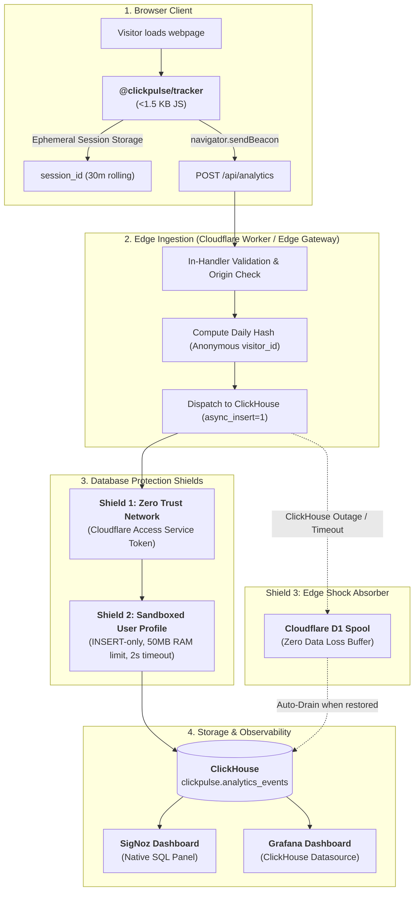

# ClickPulse ⚡

> **Lightweight, Cookieless Web Analytics Engine Built for ClickHouse & SigNoz.**  
> Zero cookies. No consent banners. Sub-millisecond queries. One single database for your infrastructure APM and website traffic.

---

## 🎯 Purpose & Motivation

Modern engineering teams and solo founders already use **ClickHouse** (via [SigNoz](https://signoz.io/), Grafana, or self-hosted clusters) as their high-performance backbone for logs, traces, and metrics.

Yet, when measuring website traffic, teams face an absurd dilemma:
1. **Google Analytics 4 (GA4):** Bloated script, confusing UI, 24-48h reporting lag, and forces intrusive GDPR/ePrivacy cookie banners on visitors.
2. **Commercial SaaS (Plausible, Fathom):** Clean, but charge aggressive recurring tiers based on pageview counts ($10–$100+/month) while siloing marketing data away from engineering observability.
3. **Self-hosted Alternatives (Umami, Plausible Community):** Require deploying heavy secondary stacks (PostgreSQL, Elixir, Redis) just for simple website stats.

### The ClickPulse Thesis
If you already run ClickHouse—the world's fastest columnar analytical engine—**you do not need another database or a separate analytics vendor**.

**ClickPulse** bridges this gap:
- An ultra-lightweight client tracker (**< 1.5 KB** gzipped).
- **100% Cookieless & Privacy-First:** No PII stored, fully compliant with GDPR/ePrivacy without requiring cookie consent banners.
- Ingests events at the edge via Cloudflare Workers / D1 and streams them straight into **ClickHouse** and **SigNoz**.
- Costs **$0/month** in additional infrastructure.

---

## ⚖️ Why Not Just Use OpenTelemetry RUM?

A common question from SREs: *"Why not just use `@opentelemetry/sdk-trace-web` (OTel RUM)?"*

OpenTelemetry Real User Monitoring and Product Web Analytics solve two fundamentally different problems:

| Dimension | OpenTelemetry RUM (`sdk-trace-web`) | ClickPulse (Web Analytics) |
| :--- | :--- | :--- |
| **Primary Audience** | SREs, Performance Engineers, Frontend Devs | Founders, Growth Engineers, Product Managers |
| **Core Question Answered** | *"Why did `/api/checkout` take 450ms? What is the p99 LCP on mobile Safari?"* | *"Where are visitors coming from? What is our bounce rate? Which campaign converted?"* |
| **Data Model** | Distributed Traces, Spans, Network Waterfalls | High-level Events (`pageview`, `outbound_click`, `session_start`) |
| **Bundle Size** | **30 KB to 150 KB+** gzipped (damages SEO & Core Web Vitals) | **< 1.5 KB** gzipped (zero dependencies) |
| **Storage & Cost** | Generates millions of indexed spans; expensive hot APM storage | Millions of rows compressed in ClickHouse for pennies; retained for years |
| **Native Concepts** | Spans, attributes, exceptions | Referrers, UTM parameters, Session duration, Bounce rate, Outbound link clicks |

> **Summary:** Use OTel RUM inside your authenticated, complex web applications for performance debugging. Use **ClickPulse** on your public landing pages, blogs, and marketing sites for privacy-first growth analytics.

---

## 🏗️ Architecture & Data Flow



### Ingestion Modes:
1. **Protected Direct Mode (Recommended / Primary):**  
   The Edge Worker posts flat, typed JSON rows directly to ClickHouse HTTP API using **`async_insert=1`** and **`wait_for_async_insert=0`**. ClickHouse buffers writes in server RAM and flushes atomic batches to disk. The connection is shielded via Cloudflare Access Service Tokens and an `INSERT`-only user capped at 50 MB RAM.
2. **Shock Absorber Fallback (D1 Spool):**  
   If ClickHouse is rebooting, under maintenance, or latency exceeds 800ms, the worker automatically spools events to Cloudflare D1. Zero data is dropped during infrastructure outages.
3. **OpenTelemetry Mode (Optional):**  
   For teams that prefer routing through an existing OpenTelemetry Collector, the worker can output standard OTLP logs (`/v1/logs`).

---

## 🔒 Privacy-First Session Tracking (Zero Cookies, No Consent Banner)

ClickPulse implements a **Hybrid Privacy Architecture**:

### 1. Client-Side: Ephemeral Session Management
- On initial page load, the tracker generates a random UUID (`crypto.randomUUID()`) and saves it in `sessionStorage`.
- It tracks a rolling 30-minute inactivity timer. If a user remains inactive for > 30 minutes, a fresh `session_id` is generated.
- When the visitor closes the browser tab, `sessionStorage` is permanently wiped by the browser.
- **Why this needs no cookie banner:** Under GDPR and the ePrivacy Directive, temporary technical tokens stored in `sessionStorage` strictly used for first-party aggregated measurement are exempt from consent requirements.

### 2. Edge-Side: Cryptographic Daily Rotating Salt
- The ingestion handler calculates an anonymous `visitor_id`:
  $$\text{visitor\_id} = \text{SHA-256}(\text{site\_id} + \text{client\_ip} + \text{user\_agent} + \text{daily\_salt})$$
- The `daily_salt` rotates every 24 hours at midnight UTC and the previous day's salt is destroyed.
- **The client's raw IP address is never written to disk or sent to ClickHouse.**
- Cross-day user tracking is mathematically impossible, preventing user profiling while enabling accurate daily unique visitor counts.

---

## 🛡️ Anti-Spam & Defensive Ingestion

Public analytics endpoints are vulnerable to spam, bot traffic, and cardinality explosion. ClickPulse protects the pipeline across multiple layers, without requiring proprietary vendor features:

1. **Perimeter / Edge Gateway (Optional WAF or Built-in Handler Checks):**
   - **External WAF (Optional):** If running behind Cloudflare or AWS, native WAF rate-limiting rules can be enabled as a first line of defense.
   - **In-Handler Protection (Always Active):** The ingestion code itself enforces request size limits (`Content-Length < 4 KB`), `POST`-only methods, and strict `Origin` header matching against configured allowed domains for the `site_id`.
   - **Rate Limiting:** In-memory or KV-backed rate limiting per IP and per `site_id` (e.g., max 60 requests/minute).
2. **Strict Schema & Payload Validation:**
   - Strict allowlist of `event_type` (`pageview`, `outbound_click`, `custom:*`). Any unrecognized events are dropped or flagged.
   - Maximum path length (255 chars), maximum 10 custom properties with depth 1.
   - Rejection of client timestamps differing by > ±5 minutes from server clock (preventing back-dated spam).
   - Bot filtering based on headless User-Agents, missing browser headers, or edge bot scores.
3. **Daily Ingestion Caps:**
   - Configurable event volume ceiling per site to prevent runaway storage consumption.
4. **ETL Quarantine:**
   - Failed schema validations are routed to an `events_rejected` table rather than dropped silently, allowing fine-tuning.
5. **ClickHouse Least Privilege:**
   - The sync worker writes using a dedicated ClickHouse user with `INSERT`-only permissions.
   - Columnar data configured with `LowCardinality(String)` and automated TTL policies (e.g., 18 months).

---

## 💾 ClickHouse Schema

```sql
CREATE DATABASE IF NOT EXISTS clickpulse;

CREATE TABLE IF NOT EXISTS clickpulse.analytics_events
(
    created_at   DateTime64(3, 'UTC') CODEC(DoubleDelta, ZSTD(1)),
    site_id      LowCardinality(String),
    event_type   LowCardinality(String),
    visitor_id   FixedString(64),
    session_id   UUID,
    path         String,
    referrer     String,
    utm_source   LowCardinality(String),
    utm_medium   LowCardinality(String),
    utm_campaign LowCardinality(String),
    country      LowCardinality(FixedString(2)),
    device_type  LowCardinality(String),
    browser      LowCardinality(String),
    event_data   String CODEC(ZSTD(3))
)
ENGINE = MergeTree()
PARTITION BY toYYYYMM(created_at)
ORDER BY (site_id, event_type, toDate(created_at), session_id, created_at)
TTL created_at + INTERVAL 18 MONTH
SETTINGS index_granularity = 8192;
```

---

## 📊 Essential Analytical Queries

With ClickHouse's speed, all standard web analytics metrics compute in single-digit milliseconds:

### 1. Daily Unique Visitors & Sessions
```sql
SELECT 
    toDate(created_at) AS date,
    uniq(visitor_id)   AS unique_visitors,
    uniq(session_id)   AS total_sessions,
    count()            AS pageviews
FROM clickpulse.analytics_events
WHERE site_id = 'my-website' AND event_type = 'pageview'
GROUP BY date
ORDER BY date DESC
LIMIT 30;
```

### 2. Bounce Rate (% of Sessions with Only 1 Pageview)
```sql
SELECT 
    round(countIf(hits = 1) * 100.0 / count(), 2) AS bounce_rate_pct
FROM (
    SELECT session_id, count() AS hits
    FROM clickpulse.analytics_events
    WHERE site_id = 'my-website' AND event_type = 'pageview'
      AND created_at >= now() - INTERVAL 7 DAY
    GROUP BY session_id
);
```

### 3. Top Outbound Conversions & Partner Clicks
```sql
SELECT 
    JSONExtractString(event_data, 'title') AS target_title,
    JSONExtractString(event_data, 'url')   AS outbound_url,
    count()                                AS click_count
FROM clickpulse.analytics_events
WHERE site_id = 'my-website' AND event_type = 'outbound_click'
  AND created_at >= now() - INTERVAL 30 DAY
GROUP BY target_title, outbound_url
ORDER BY click_count DESC
LIMIT 20;
```

---

## 🚀 Quickstart & Deployment (3 Steps)

### Step 1: Initialize ClickHouse
Run the production DDL in your ClickHouse cluster to create the database, tables, materialized views, and the sandboxed user:
```bash
clickhouse-client < schema.sql
```

### Step 2: Deploy the Edge Ingestion Worker
Navigate to the edge worker directory, configure your environment secrets, and deploy to Cloudflare:
```bash
cd packages/edge-worker
npx wrangler secret put CLICKHOUSE_PASSWORD
npx wrangler secret put CF_ACCESS_CLIENT_SECRET
npx wrangler deploy
```

### Step 3: Embed in Any Consumer Website (Multi-Tenant)
ClickPulse is **multi-tenant by design**. You run **one** ClickHouse table and **one** edge worker to track multiple independent websites. Simply assign a unique `site_id` to each property.

#### Option A: Hosted CDN via GitHub Pages (Zero Files to Vendor)
Embed directly from the automated GitHub Pages CDN (powered by Fastly) without copying any files into your consumer repo:
```html
<script defer
  src="https://<your-username>.github.io/clickpulse/tracker.min.js"
  data-site="my-first-site"
  data-endpoint="https://analytics.yourdomain.com/api/analytics">
</script>
```

#### Option B: Self-Hosted / Local Static Embed (Hugo, WordPress, Custom)
Copy `public/tracker.min.js` to your static folder and embed locally:
```html
<script defer
  src="/js/tracker.min.js"
  data-site="my-first-site"
  data-endpoint="https://analytics.yourdomain.com/api/analytics">
</script>
```

#### Option C: NPM / TypeScript (Next.js, React, Vue, Astro, Svelte)
```typescript
import { init, track, pageview } from '@clickpulse/tracker';

init({
  siteId: 'my-first-site',
  endpoint: 'https://analytics.yourdomain.com/api/analytics',
  autoPageview: true,
  trackOutbound: true,
  outboundDomains: ['partner-domain.com'] // Auto-tracks affiliate/outbound clicks
});

// Custom event tracking
track('search', { query: 'Iceland', min_price: 1500 });
```

---

## 🗺️ Project Structure & Roadmap

```
clickpulse/
├── packages/
│   ├── tracker/          # < 1.5 KB Vanilla JS / TypeScript browser SDK
│   │   ├── src/
│   │   │   ├── index.ts
│   │   │   ├── session.ts
│   │   │   └── outbound.ts
│   │   ├── package.json
│   │   └── tsconfig.json
│   ├── edge-worker/      # Cloudflare Worker ingest handler
│   │   ├── src/
│   │   │   ├── clickhouse.ts  # Direct protected ClickHouse client (async_insert=1)
│   │   │   ├── otlp.ts        # Optional OpenTelemetry v1/logs exporter
│   │   │   ├── hash.ts        # Cryptographic daily rotating salt visitor hash
│   │   │   ├── schema.ts      # Strict input sanitization & rate bounds
│   │   │   └── index.ts       # Worker entrypoint with CORS & D1 spool fallback
│   │   ├── wrangler.toml
│   │   └── tsconfig.json
│   └── sync-cli/         # Python ETL worker to drain D1 shock absorber spool
│       ├── src/
│       │   ├── clickhouse.py
│       │   ├── d1.py
│       │   └── main.py
│       ├── requirements.txt
│       └── Dockerfile
├── dashboards/
│   ├── signoz/           # Native SigNoz Web Analytics dashboard JSON
│   └── grafana/          # Grafana ClickHouse datasource dashboard JSON
├── docs/                 # Architectural Decision Records (ADRs) & Query Cookbooks
│   ├── adr/
│   └── clickhouse-queries.md
├── schema.sql            # ClickHouse production DDL & sandboxed user profiles
└── README.md
```

### Milestones
- [x] Architectural specification & RFC definition
- [x] Modularize browser tracker (`@clickpulse/tracker`) with TypeScript (< 1.5 KB gzipped)
- [x] Protected Direct ClickHouse ingestion (`async_insert=1`) with 3-shield defense
- [x] Cloudflare D1 shock absorber spool for 100% zero data loss during server outages
- [x] Optional OpenTelemetry Semantic Conventions for Events (`/v1/logs`)
- [x] ClickHouse production schema with sandboxed user roles & materialized views
- [x] Native SigNoz and Grafana dashboard templates
- [ ] Deploy and configure consumer websites (e.g. web app, personal blog)
- [ ] Publish Open-Core repository on GitHub with "Show HN" announcement

---

## 📜 License

MIT License. Built for independent builders, SREs, and teams who care about privacy and performance.
